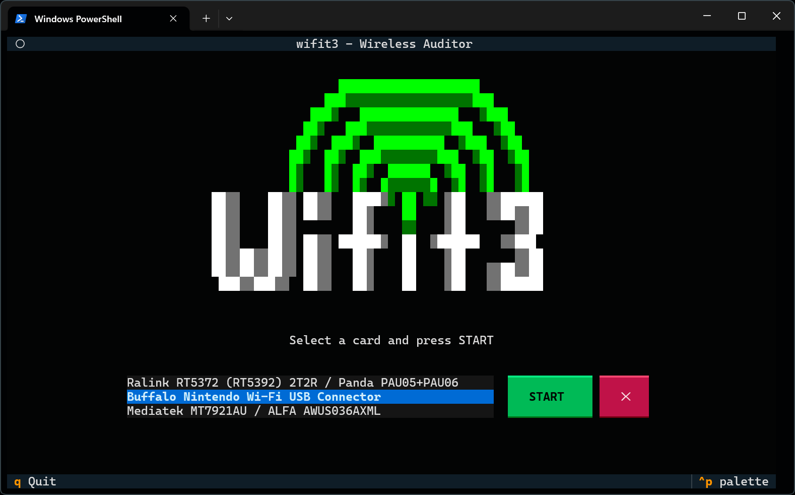
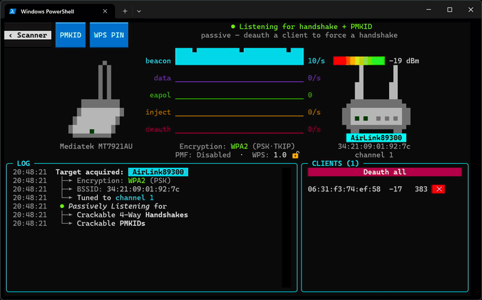
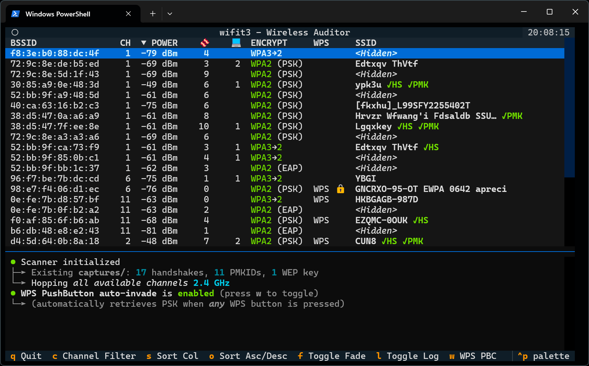
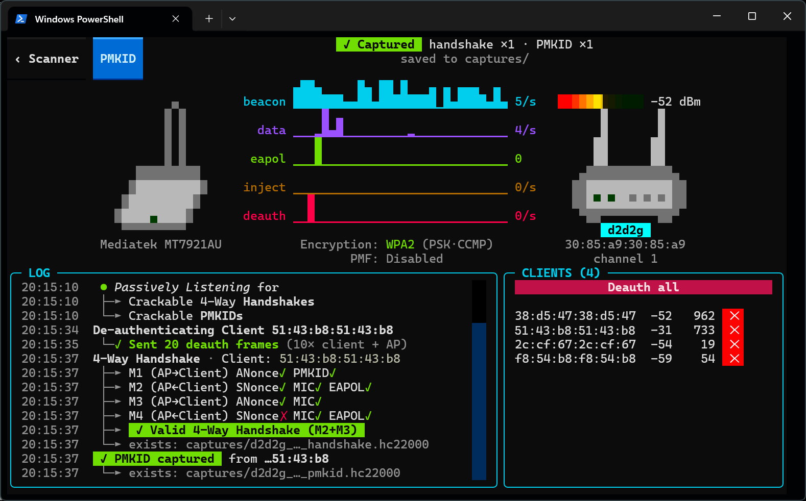

# wifite3 (wifit3)
> A standalone USB Wi-Fi auditor for Linux, Windows, and macOS.

[](https://github.com/dyal96/wifite3)
[](https://github.com/derv82/wifit3)
[](LICENSE)

> [!NOTE]
> This repository is a maintained fork at [**dyal96/wifite3**](https://github.com/dyal96/wifite3).  
> The original project and revolutionary userland USB wireless architecture were created by **derv82** at [**derv82/wifit3**](https://github.com/derv82/wifit3). Full attribution and credit belong to derv82 and the upstream contributors.

<p align="center">
  
</p>

> *At least* one of the [supported USB adapters](#supported-hardware) is **required**.

---

## Why?
* **Cross-Platform:** Runs identically on Linux, macOS, and Windows.
* **Wireless Driver Heaven:** Built-in wireless micro-drivers bypass OS kernel driver versioning issues and Windows NDIS limitations.
* **Zero Runtime Dependencies:** No `aircrack-ng` or `reaver` required -- pure Python powered by PyUSB & Textual.
* **Full Automation:** Automated field auditing mode (`--auto`) cycles targets by exploitability without requiring manual intervention.

<p align="center">
  
</p>

---

## Features

### Automated Field Auditing (`--auto` / `-a`)
- **Hands-Free Pipeline:** Automatically selects interfaces, launches scanning, scores targets, runs attack campaigns, and logs results.
- **Priority Scoring Matrix:** Targets are evaluated and attacked in order of vulnerability:
  - WPS Unlocked (+100 score)
  - WEP (+80 score)
  - WPS Push-Button Active (+70 score)
  - WPA2 Crackable (+50 score)
  - WPA3-only networks are skipped automatically
- **Target Skipping (`N` / `Next ›`):** Press `N` or click `Next ›` in Focus view to skip the current AP immediately. In Auto Mode, wifite3 marks the AP visited, grabs the next highest-scoring candidate, and continues attacks seamlessly.
- **Campaign Chaining:** Focus auto mode seamlessly steps through: Vault check -> Decloak -> WEP -> WPS PBC -> WPS PixieDust/PIN -> PMKID -> AutoDeauth.
- **Session Progress Reporting:** Summary toast notifications and persistent audit reports (`"X APs scanned, Y cracked"`).

### Continuous Learning & Wordlists
- **Auto-Learned Passwords:** Any password recovered during WPA CPU cracking, Hashcat, or WPS PIN/PBC attacks is automatically appended to `wordlists/cracked_wordlists.txt`.
- **Adaptive Guess List:** Newly cracked passwords are automatically prioritized at the front of the dictionary queue for future targets, accelerating audits across related access points.
- **Custom Wordlist Generation:** To create tailored target dictionaries based on personal keywords, dates, or organizational patterns, check out [**dyal96/Custom-Wordlist-Generator**](https://github.com/dyal96/Custom-Wordlist-Generator).

### Mobile Field Auditing (Android Termux OTG)
- **Zero Laptop Required:** Audit entirely from an Android phone using standard USB OTG and a supported Wi-Fi adapter.
- **One-Line Installer:** Automated setup via `curl -sSL https://raw.githubusercontent.com/dyal96/wifite3/main/termux-setup.sh | bash`.
- **Detailed Mobile Guide:** Full setup, non-root `termux-usb` routing, and display optimization documented in [`termux-guide.md`](termux-guide.md).

### Reconnaissance & Analysis
- **Multi-Card Aggregation:** Capture packets across multiple adapters simultaneously; pick a dedicated card to inject.
- **Real-Time Scanner:** 2.4GHz & 5GHz channel-hopping (split across cards via SPREAD); tracks signal strength, encryption suites, WPA3/SAE transition modes.
- **AP & Client Identification:** Fingerprints device vendors and categories; extracts router make and model from WPS beacons.
- **VAP Decloaking:** Identifies hidden networks by correlating their BSSIDs with known visible siblings and directed probe requests.
- **Packet Dashboard:** Visualizes real-time beacon, data, injection, and deauthentication packet rates.

### Attacks & Captures
- **WPA/WPA2 Handshakes:** Passive sniffing and targeted deauthentication; validates crackable pairs; exports `.pcap` and `.hc22000` files.
- **PMKID Harvesting:** Active association harvest and passive sniffing for WPA/WPA2 PMKID key material (`.hc22000`).
- **EvilTwin WPA3 Downgrade:** Clones the AP and evicts clients (via CSA, BTM, and de-auths) to capture handshakes on single or multiple cards.
- **WPS Recovery Suite:**
  - **PixieDust:** Offline PIN recovery exploiting *Null Secret*, *Static Secret*, Ralink LFSR, and RTL819x glibc timestamp PRNG weaknesses.
  - **PushButton (PBC):** Detects physical WPS button presses and immediately extracts the plaintext WPA PSK.
  - **PIN Brute-Force:** Resumable WPS PIN cracking with known-PIN database and AP lock monitoring.
- **WEP Suite:** Pure Python ARP replay, ChopChop, Fake Authentication, and PTW key recovery.

---

## Architecture & System Documentation

For detailed technical references, refer to the project documentation:
- **[`architect.md`](architect.md):** Complete architectural blueprint covering the USB micro-driver engine, packet deduplication pipeline (`WlanSink`), radio mutex (`Campaign.active`), and data models.
- **[`termux-guide.md`](termux-guide.md):** Complete step-by-step Android Termux OTG mobile field auditing guide with automated bootstrap script.
- **[`todo.md`](todo.md):** Active roadmap, feature tracking, and Android/Termux portability plan.

---

## Screenshots

| Scanner | Focus (Single Target) |
|---|---|
|  |  |

---

## Supported Hardware

> **Important:** *At least one supported USB wireless adapter is required.*

| Chipset | Bands | Cards (Make + Model) |
|---|---|---|
| Atheros AR9271 | 2.4 GHz | ALFA AWUS036**NHA**, TP-Link TL-WN722N V1 |
| MediaTek MT7601U | 2.4 GHz | Generic unbranded "nano" dongles |
| MediaTek MT7610U | 2.4 / 5 GHz | ALFA AWUS036**ACHM**, Panda PAU0B |
| MediaTek MT7612U | 2.4 / 5 GHz | ALFA AWUS036**ACM** |
| MediaTek MT7921AU | 2.4 / 5 GHz | ALFA AWUS036**AXM[L]**, Panda PAU0F |
| MediaTek MT7925U | 2.4 / 5 GHz | Netgear A9000 |
| Realtek RTL8812AU | 2.4 / 5 GHz | ALFA AWUS036**ACH** |
| Realtek RTL8814AU | 2.4 / 5 GHz | ALFA AWUS1900, ASUS USB-AC68 |
| Realtek RTL8821AU | 2.4 / 5 GHz | ALFA AWUS036**ACS**, TP-Link Archer T2U Plus/Nano |
| Realtek RTL8821CU | 2.4 / 5 GHz | Auscoumer 600 Mbps, Mercusys MU6H |
| Realtek RTL8922AU | 2.4 / 5 GHz | ASUS USB-BE93 |
| Realtek RTL8822BU | 2.4 / 5 GHz | TP-Link T3U Plus, Archer T4U v3 / T4U+ |
| Realtek RTL8822CU | 2.4 / 5 GHz | D-Link AC13U |
| Realtek RTL8187L | 2.4 GHz | ALFA AWUS036**H** |
| Realtek RTL8188EUS | 2.4 GHz | TP-Link TL-WN722N v2/v3, Mercusys MW150US |
| Realtek RTL8188FTV | 2.4 GHz | Generic unbranded dongles |
| Realtek RTL8192FU | 2.4 GHz | D-Link AN3U rev. A1 |
| Ralink RT2570 | 2.4 GHz | Buffalo Nintendo Wi-Fi USB Controller |
| Ralink RT3070 | 2.4 GHz | ALFA AWUS036**NH**, TP-Link TL-WN7200ND |
| Ralink RT5370 | 2.4 GHz | LOTEKOO 150 Mbps |
| Ralink RT5372 | 2.4 GHz | Panda PAU05/PAU06 |
| Ralink RT5572 | 2.4 / 5 GHz | Panda PAU09 N600 |

For breakdown of each device's capabilities and limitations, see the [Supported Hardware Documentation](docs/SUPPORTED-HARDWARE.md).

---

## Installation & Running

### Option 1: Run from Source (Recommended)
This repository uses Astral's [`uv`](https://docs.astral.sh/uv/) for fast, deterministic environment management:

```bash
# Clone this repository
git clone https://github.com/dyal96/wifite3.git
cd wifite3

# Quick launch on Linux (auto-configures environment and launches):
chmod +x run.sh && ./run.sh

# Or run directly in full Auto Mode:
./run.sh --auto

# Or manual execution with uv:
uv sync
uv run wifit3
```

### Option 2: Prebuilt Binaries
Download standalone executables from [**Releases**](https://github.com/dyal96/wifite3/releases/latest) (or upstream releases at [derv82/wifit3/releases](https://github.com/derv82/wifit3/releases)):

* **Windows:** Download and run `wifit3-windows-x64.exe`.
* **Linux (non-sudo):** `chmod +x wifit3-linux-x64 && ./wifit3-linux-x64`
* **macOS:** (bypass quarantine)
  ```bash
  xattr -d com.apple.quarantine wifit3-macos-universal2
  chmod +x wifit3-macos-universal2
  ./wifit3-macos-universal2
  ```

### Option 3: Build Standalone Binary
```bash
uv run pyinstaller wifit3.spec --noconfirm --clean
```
Binary executable is produced in the `dist/` subdirectory.

---

## One-Time Driver Setup

wifit3 automatically configures required USB permissions when clicking `START`:

- **Linux:** Prompts once via `pkexec`/`sudo` to write udev permissions and blocklists in `/etc/modprobe.d/`.
- **macOS:** No installation required; plug in the device and select *Allow* in the system authorization dialog.
- **Windows:** Prompts once via UAC to configure WinUSB for the device.
- **VirtualBox:** Add your USB device(s) to VirtualBox's `USB Filters` *before* plugging in.

### Reverting / Uninstalling
To return the device to your operating system's native Wi-Fi stack:
1. Select the card on the wifit3 splash screen.
2. Click `Uninstall` and confirm.
3. Accept the elevation prompt (UAC on Windows or `pkexec` on Linux).
4. Unplug and re-plug the adapter.

---

## Credits & Upstream Attribution

### Original Author & Project
- **[derv82](https://github.com/derv82)**: Creator of the original [**derv82/wifit3**](https://github.com/derv82/wifit3) project and architect of the pure-Python USB micro-driver userland stack.

### Community & Linux Drivers
This software builds upon the dedication of the open-source wireless community who reverse-engineered and maintained Linux wireless drivers:
- **Christian "kimo" B. ([@kimocoder](https://github.com/kimocoder))**: Maintainer of **wifite2** and `aircrack-ng`'s RTL8188EUS DKMS driver.
- **[Neur0sp1cy](https://github.com/neur0sp1cy)**: Wireless research guidance and mentorship.
- **Nick Morrow ([@morrownr](https://github.com/morrownr))**: Maintainer of out-of-tree Realtek USB DKMS drivers.

See **[CREDITS.md](docs/CREDITS.md)** and **[ACKS.md](docs/ACKS.md)** for full acknowledgments.

---

## License & Disclaimer

- **Code:** Licensed under [**GNU General Public License v2.0**](LICENSE) (matching upstream Linux drivers).
- **Firmware:** Vendor firmware blobs loaded onto adapters are redistributed verbatim under their respective manufacturers' licenses (details in [FIRMWARE.md](docs/FIRMWARE.md)).
- **⚠️ Notice & Disclaimer:** For use only on networks and equipment you own or are explicitly authorized to audit. Operating directly on USB hardware registers carries responsibility; use ethically and at your own risk.
