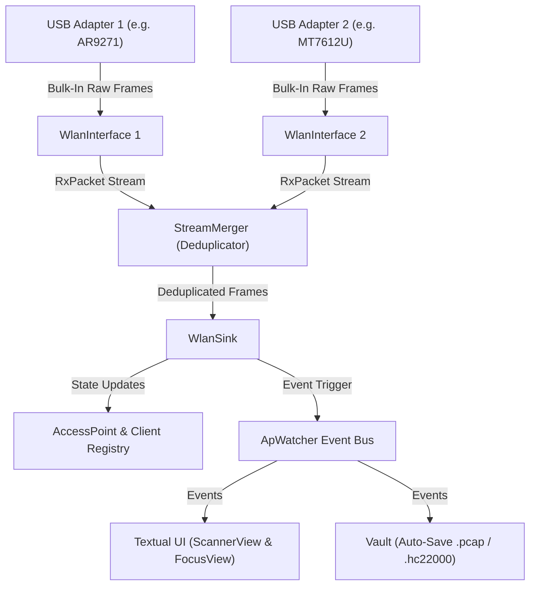
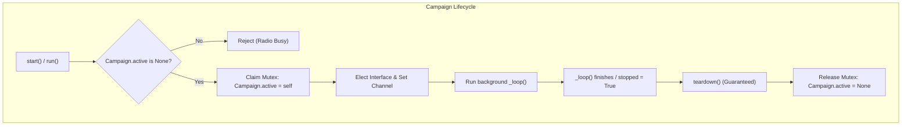
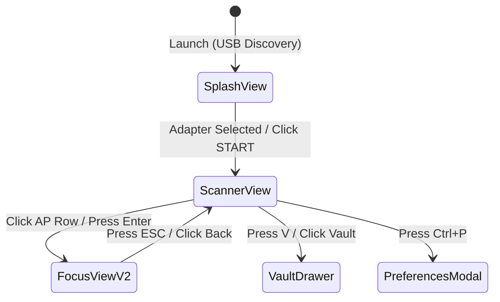
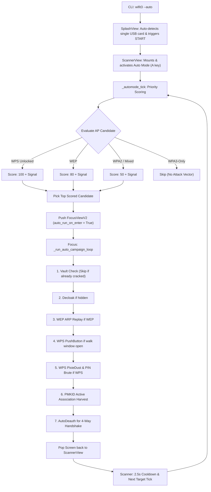

# wifit3 -- Architectural Blueprint & System Reference

> **Companion Document:** `todo_list.md` (or `todo.md`)  
> **Purpose:** Comprehensive technical reference covering every subsystem, data flow, hardware abstraction, and operational mechanic in `wifit3`. Designed so developers and AI agents can understand, navigate, and plan tasks across the entire codebase without re-reading dozens of source files.

---

## 1. System Overview & Core Philosophy

`wifit3` is an independent, pure-Python 802.11 wireless auditing tool designed for Linux, Windows, and macOS.

### Key Architectural Tenets:
1. **Userland Wireless Stack (Bypasses OS Wi-Fi Drivers):**
   - Does **not** use Linux kernel `mac80211`/`cfg80211` monitor mode, `aircrack-ng`, `scapy`, or Windows NDIS.
   - Communicates directly with USB wireless adapters over USB Control and Bulk endpoints using **PyUSB** / **libusb**.
   - Contains native, lightweight Python ports of Linux kernel Wi-Fi drivers (`src/wifit3/chips/`).
2. **Zero External Runtime Dependencies:**
   - Runs purely with standard Python, PyUSB, and the Textual TUI framework.
   - Hashcat, John the Ripper, and aircrack-ng are optional auxiliary tools managed via the Vault subsystem.
3. **Multi-Card Aggregation & SPREAD Hopping:**
   - Supports arbitrary combinations of supported USB Wi-Fi dongles plugged in simultaneously.
   - Channel hopping dynamically partitions bands across all available adapters (SPREAD).
   - Dedicated cards can be dynamically elected or pinned for packet injection while others sniff.
4. **Radio Mutual Exclusion (`Campaign.active`):**
   - Half-duplex USB wireless hardware cannot execute conflicting attacks simultaneously.
   - A single global class-level mutex (`Campaign.active`) guards the physical radio.

---

## 2. Directory & Package Topology

The repository is divided into two distinct architectural tiers:

```
src/wifit3/
├── chips/        # Low-level hardware drivers (one folder per chipset family)
├── device/       # USB enumeration, hotplug watchers, VID:PID database
├── dot11/        # Pure 802.11 / WSC / RSN frame parsers, builders, and crypto
├── wlan/         # Hardware abstraction: interfaces, multi-card array, deduplication, sink
│
├── models/       # Domain data models: AccessPoint, Client, Handshake, ApIdentity
├── persist/      # Config (TOML), capture storage, AP persistent states (.meta)
├── watchers/     # Asynchronous live event streams (ApWatcher, capture events)
├── id/           # OUI lookups, WPS router fingerprinting, client OS identification
├── crack/        # Offline cryptographic verification (WPA PSK, WEP PTW, hc22000)
├── vault/        # Cracking job coordinator (hashcat, CPU cracker, dictionary manager)
├── campaigns/    # Automated attack state machines (Deauth, PMKID, WPS, WEP, EvilTwin)
├── setup/        # Privileged platform installer (udev/modprobe on Linux, WinUSB on Windows)
└── ui/           # Textual TUI application (Splash, Scanner, FocusV2, Vault, Modals)
```

### Core Engine vs. Application Layer
- **Core Engine (`dot11`, `device`, `wlan`, `chips`):** Completely decoupled from UI and product concepts. Meant to eventually be usable as a standalone headless Python library.
- **Application Layer (`models`, `persist`, `watchers`, `campaigns`, `vault`, `ui`):** Coordinates user workflows, visual presentation, persistent storage, and attack orchestration.

---

## 3. Hardware Layer & USB Micro-Drivers (`chips/`, `device/`)

### 3.1 Device Identification (`device/`)
- `supported_ids()`: Scans all chip modules dynamically to compile a map of `(VendorID, ProductID) -> DriverFactory`. This is done **without importing driver implementations** to keep startup instantaneous.
- `DeviceManager`: Scans the USB bus, checks device status (Available, Busy/In-use, Needs Driver), and manages driver claims.
- `DeviceWatch`: Polling background thread watching USB add/remove events for live hotplugging.

### 3.2 Chip Driver Structure (`chips/<chipset>/`)
Every supported chipset implements the `Driver` abstract base class (`src/wifit3/chips/driver.py`). A driver directory standardly contains:

| Module | Responsibility |
|---|---|
| `__init__.py` | Declares `SUPPORTED_IDS` list and `import_driver()` entry point |
| `driver.py` | Subclasses `Driver`; defines `SUPPORTED_CHANNELS`, `BAND`, `FAKE_MAC` support |
| `transport.py` | USB control pipe commands, endpoint claim, bulk-in / bulk-out loops |
| `firmware.py` | Uploads vendor binary firmware blobs onto the adapter's MCU on initialization |
| `mac.py` / `phy.py` | Register-level configuration ported from Linux kernel C drivers |
| `chan.py` | Frequency/channel tuning synthesizer routines |
| `rx.py` / `tx.py` | Hardware descriptor packing/unpacking and frame serialization |

### 3.3 Spoofed MAC Capabilities (`FakeMacSupport`)
Cards report their MAC spoofing ability via `driver.FAKE_MAC`:
- `SPOOFABLE`: Card firmware and hardware can transmit from arbitrary MAC addresses (ideal for attacks).
- `FIXED_MAC`: Hardware requires using the factory-programmed MAC address.
- `NONE` / `UNIMPLEMENTED`: Cannot spoof; restricted from attacks requiring impersonation (e.g., EvilTwin).

---

## 4. Wireless Data Flow & State Engine (`wlan/`, `dot11/`)



### 4.1 `WlanInterface`
Represents an individual physical USB radio. Handles:
- Operating channel setting and channel hopping loops.
- Asynchronous bulk RX packet loop yielding decoded 802.11 frames.
- Low-level frame transmission (`inject_frame`, `deauth_client`, `deauth_broadcast`).

### 4.2 `WlanArray` (Multi-Card Aggregator)
- **Unified Radio Pool:** Holds all attached `WlanInterface` instances.
- **Dynamic Channel Hopping (SPREAD):** Partitions channels across all member devices (e.g., Card 1 hops 2.4 GHz channels 1–6, Card 2 hops 7–14 and 5 GHz).
- **Interface Selection (`select_iface`):** When an attack requires transmission on channel $C$, selects the best member card matching $C$ based on `fake_mac_rank` and user session preference.

### 4.3 `WlanSink` & Deduplication
- `StreamMerger`: Reorders and deduplicates frames received across multiple cards listening to overlapping channels within a sliding time window (default 300ms).
- `WlanSink`: Parses 802.11 beacons, probe responses, association frames, EAPOL exchanges, and WSC information elements.
- Updates live `AccessPoint` and `Client` data models in-place.
- Emits atomic domain events via `ApWatcher` (e.g., `HandshakeCaptured`, `PmkidCaptured`, `ApDecloaked`, `PbcWindowOpened`).

---

## 5. Domain Models & Persistence (`models/`, `persist/`, `vault/`)

### 5.1 Models
- **`AccessPoint` (`models/access_point.py`):**
  - Identifiers: `bssid`, `ssid`, `channel`, `signal` (smoothed dBm across cards).
  - Security Profile: `encryption`, `akms`, `akm_suites`, `wpa3`, `transition_mode`, `pmf_posture`.
  - WPS Metadata: `wps`, `wps_locked`, `wps_version`, `wps_selected_registrar`, `wps_pbc_active`.
  - Identity: `identity` (`ApIdentity` populated from OUI, DHCP, WPS M1 fingerprints).
  - Telemetry: `beacons`, `last_seen`, `handshakes` (per-client map), `wep` IV counts.
- **`Client` (`models/client.py`):** Associated MAC, target BSSID, packet counters, signal strength, fingerprint.

### 5.2 Persistence & Capture Hierarchy (`captures/`)
Recovered artifacts are saved automatically to the `captures/` directory:
- **`*.pcap`**: Full 4-way EAPOL handshakes and WEP IV captures.
- **`*.hc22000`**: Hashcat-ready WPA-PBKDF2 PMKID / EAPOL hashes.
- **`*.meta`**: JSON sidecars storing network metadata, recovered plaintext PSKs, WPS PINs, and WEP keys.
- **`wordlists/cracked_wordlists.txt`**: Plaintext cracked passwords auto-appended upon recovery across WPA PSK and WPS PIN/PBC attacks, immediately fed into subsequent attack guess lists. For custom dictionary creation, see [dyal96/Custom-Wordlist-Generator](https://github.com/dyal96/Custom-Wordlist-Generator).

---

## 6. Attack & Campaign Engine (`campaigns/`)

All attacks inherit from `Campaign` (`src/wifit3/campaigns/campaign.py`).



### 6.1 Attack Implementations

| Campaign | Key | Target Encryption | Mechanism | Payoff / Output |
|---|---|---|---|---|
| **AutoDeauth** | `deauth` | WPA / WPA2 | Unicast deauth to each active client in round-robin, followed by broadcast burst | Forces client reconnection, provoking 4-way handshake |
| **PMKID Harvest** | `pmkid` | WPA / WPA2 | Sends directed 802.11 Association Request with RSN IE containing PMKID request | Captures Router M1 frame containing PMKID (`.hc22000`) without clients |
| **WPS PushButton** | `pbc` | WPS (Active) | Detects Push-Button walk window (`DevPwId 0x0004`), associates and walks EAP-WSC M1–M8 | Retrieves plaintext WPA PSK instantly |
| **WPS PixieDust** | `wps` | WPS | Analyzes WPS M3 nonces for weak PRNGs (Null Secret, Static Secret, Ralink LFSR, RTL819x glibc timestamp) | Recovers WPS PIN offline in seconds |
| **WPS PIN Brute** | `wps` | WPS | Known vendor PIN database lookup, followed by 4+3 checksum split brute-force | Recovers WPS PIN and plaintext PSK |
| **WEP Suite** | `wep` | WEP | ARP Request Replay, ChopChop packet decryption, Fragmentation attack, PTW solver | Recovers 64-bit / 128-bit WEP key |
| **EvilTwin** | `eviltwin` | WPA2 / WPA3 | Sets up cloned AP with forged BSSID/SSID on alternate channel; punts clients via CSA/BTM/Deauth | Captures WPA2 handshake from WPA3-transition devices |
| **Decloak** | `decloak` | Hidden SSID | Directed probe requests based on known client probes, wordlists, and VAP sibling correlation | Reveals hidden SSID name |
| **Verify** | `verify` | Any Saved | Attempts full association and key derivation using stored credentials | Validates credential freshness without UI disruption |

---

## 7. User Interface & Screen Architecture (`ui/`)

The TUI is built on Textual and operates across three primary screens:

### 7.1 Screen Progression



1. **`SplashView` (`src/wifit3/ui/screens/splash.py`):**
   - Discovers connected USB wireless dongles.
   - Shows device name, chipset, supported frequency bands (2.4G / 5G), and driver status.
   - Provides one-click driver installation/uninstallation (WinUSB / udev).
2. **`ScannerView` (`src/wifit3/ui/screens/scanner.py`):**
   - Active AP data table (`APTable`) updating at 15 FPS.
   - Columns: BSSID, SSID, Channel, Signal (dBm sparkline / bar), Encryption, WPS, Beacons, Clients.
   - Interactive filtering (text query, encryption type, minimum power, band filter).
   - Real-time channel hopper status readout.
3. **`FocusViewV2` (`src/wifit3/ui/screens/focus_v2/screen.py`):**
   - Router & Card ASCII spatial endpoints with live transmission activity LEDs.
   - Sparkline packet dashboard (Beacons, Data, EAPOL, WEP IVs, Deauths, Injections).
   - Associated stations client table with per-client deauthentication triggers.
   - Dynamic attack button row reflecting available attack vectors for the target's configuration.
   - Real-time forensic tree log.

---

## 8. Auto Mode Architecture (`--auto` / `-a`)

Auto Mode enables zero-touch automated field auditing. It connects Splash, Scanner, and Focus into a self-driven pipeline:



### Auto Mode Operational Rules:
- **Priority Scoring:** Fastest/highest-probability attack vectors are prioritized first (WPS > WEP > WPA2).
- **Visited AP Memory:** Avoids looping on previously audited APs within the session.
- **Graceful Back-off:** When returning from Focus, a 2.5-second cooldown allows the hopper to refresh airspace before selecting the next target.
- **Summary Reporting:** When stopped, ScannerView displays a summary toast and logs: `"X APs scanned, Y cracked"`.

---

## 9. Android & Field Portability Roadmap

Because `wifit3` is **pure Python** with no native kernel C dependencies, it can run on Android via Termux over USB OTG:

### Architecture for Android OTG:
1. **OTG Hardware:** Low-power nano dongles (e.g., MediaTek MT7601U, Atheros AR9271, Realtek RTL8188EUS).
2. **Userland libusb:** Termux `libusb` package accesses device nodes via Android USB Host API / `termux-usb`.
3. **Headless & Touch Operation:** Auto mode (`wifit3 --auto`) allows pocket operation without requiring a physical keyboard.
4. **Native Android Wrapper (M5 Milestone):** Kotlin APK wrapper passing open USB file descriptors (`WIFIT3_USB_FD`) directly to PyUSB without requiring root permissions.

---

## 10. Developer Guardrails & Maintenance Rules

When editing this codebase, adhere strictly to these rules:

1. **Never Run `ruff format`:** Only run `ruff check src/`. Code formatting is deliberately hand-aligned for data tables and bitwise constants.
2. **Docstring Discipline:** Comments and docstrings only on public APIs, maximum 2 lines. Do not comment self-explanatory code.
3. **No Em-Dashes (U+2014):** Use standard ASCII hyphens (`--` or `-`).
4. **Environment & Tests:**
   - Always run commands via `uv run` (e.g., `uv run pytest`).
   - All USB communications in tests are mocked; tests never require attached hardware.
5. **Driver Changes (`src/wifit3/chips/`):**
   - Follow `docs/porting/METHODOLOGY.md` strictly when modifying or adding chipset drivers.
   - Do not import application layer modules (`ui`, `campaigns`, `vault`, `models`) into `chips/`.
