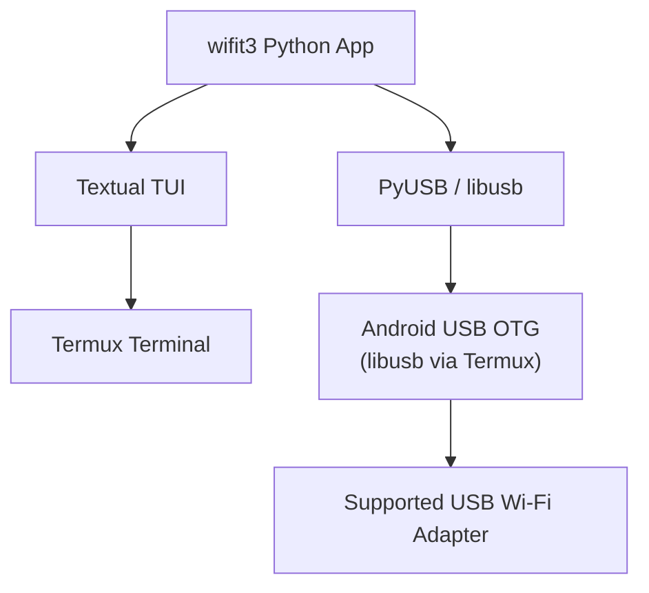
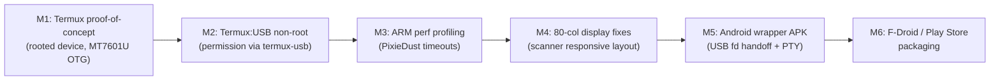

# wifit3 -- Project TODO & Roadmap

> Last updated: 2026-11-09

---

## ✅ Completed -- Auto Mode Feature (Session 2026-11-09)

The full **Auto Mode** feature was implemented across three dimensions:

### 1. CLI `--auto` / `-a` Flag
- **File**: `src/wifit3/__main__.py`
- Adds `-a` / `--auto` argument to argparse
- Passes `auto_mode=args.auto` into `WifiteApp()`
- Usage: `uv run wifit3 --auto` → skips all manual TUI steps

### 2. Splash Auto-Start
- **File**: `src/wifit3/ui/screens/splash.py`
- When `--auto` is passed and exactly one USB adapter is found, auto-clicks `START` via `set_timer(0.2, self.action_start)`
- Guards `guessid()` against `self.array` being `None`

### 3. Scanner Auto Mode (multi-target cycling)
- **File**: `src/wifit3/ui/screens/scanner.py`
- Toggle with `A` key or new **Auto Mode** binding in footer
- Cycles through all visible APs by signal strength (strongest first)
- Skips already-visited and already-cracked APs
- After returning from FocusView, waits 2.5s before ticking to the next target
- When `--auto` CLI flag active, scanner auto-starts on mount

### 4. Focus Auto Mode (attack chain on single AP)
- **File**: `src/wifit3/ui/screens/focus_v2/screen.py`
- New **Auto** / **Stop Auto** button in the attack button strip
- Toggle with `A` key
- Attack sequence: Vault check → WPS/WEP → WPS PIN → PMKID → Deauth
- If cracked: logs PSK, stops. If launched from scanner auto mode: pops back to scanner
- `auto_run_on_enter` flag allows scanner to signal focus to auto-start campaign chain

### 5. Tests -- `tests/ui/test_automode.py` (new, 6 tests)
| Test | Status |
|---|---|
| `test_cli_auto_argument` | ✅ PASS |
| `test_splash_auto_mode_triggers_start` | ✅ PASS |
| `test_scanner_toggle_automode` | ✅ PASS |
| `test_scanner_automode_tick_selects_target` | ✅ PASS |
| `test_focus_auto_button_and_toggle` | ✅ PASS |
| `test_focus_auto_campaign_loop_skips_when_already_cracked` | ✅ PASS |

### Pre-existing failures (do NOT fix)
| Test | Reason |
|---|---|
| `test_job_pane.py::test_the_bar_fills_its_box_and_the_percentage_has_two_decimals` | Pre-existing layout bug |
| `test_scanner_row_cache.py::test_encryption_upgrade_is_seen` | Pre-existing timing bug |

---

## 🔄 Remaining Features & Updates

### HIGH PRIORITY

#### Auto Mode Improvements
- [x] **Next target skip hotkey (`n`)** -- Bound `n` key and added "Next ›" button to FocusViewV2 to skip the current target and advance to the next target AP immediately (both in Auto Mode and manual mode). Bound `n` in ScannerView to advance cursor across targets.
- [x] **Auto-append cracked passwords to guess list** -- Recovered PSKs from WPA or WPS PIN/PBC are automatically appended to `wordlists/cracked_wordlists.txt` and prioritized in future cracking jobs. Documented [dyal96/Custom-Wordlist-Generator](https://github.com/dyal96/Custom-Wordlist-Generator).
- [x] **App & script namespace update** -- Updated app title in `src/wifit3/ui/app.py` and scripts (`run.sh`, `termux-setup.sh`) to `dyal96`, while maintaining upstream attribution in `README.md`.
- [x] **AP priority scoring in `_automode_tick`** -- Implemented scoring matrix:
  - WPS-enabled → score +100
  - WEP → score +80
  - WPA2 (no PMKID seen yet) → score +50
  - WPA3-only → skipped entirely (no attack vector)
  - Signal strength (0-100) tie-breaker within tiers
- [x] **Auto mode progress summary** -- Summary Toast + tree log on disable: `"X APs scanned, Y cracked"`
- [x] **Stop Auto Mode on `ESC` / back** -- Confirmed hooked; `FocusViewV2.action_go_back()` calls `stop_auto_mode()`, stopping background workers and returning to Scanner.
- [ ] **AutoDeauth settings modal** -- Add settings panel for Deauth (methods, multi-card). See `docs/planning/FEATURES.md`

#### Bug Fixes (from BUGS.md)
- [x] **PixieDust eCos high-nonce-byte bug** -- `ecos_simple_recover` rejects nonces with bit 7 set early (`e_nonce[0] & 0x80`), avoiding corrupted seed sweeps.
- [x] **PixieDust glibc seeding modelled as unsigned** -- Verified resolved in `_glibc_seeded_words` with `int32_t` sign-extension past 2^31.
- [x] **PixieDust never tests empty PIN half** -- Verified handled via `oracle.empty_psk` in `_find_first_half` and `_find_second_half`.
- [x] **PixieDust first-half recomputes PSK1 per seed** -- Verified using `_HalfOracle._psk` lazy precomputed cache.
- [x] **PixieDust RTL819x discards recovered first PIN half** -- Verified `_Found(first_half=first4)` handoff into `CampaignState.first_half` for online P2 sweep.
- [x] **PixieDust second-half skips checksum-invalid PINs** -- Sweeps all 10000 4-digit halves in `_find_second_half` and covered by `test_second_half_recovery_accepts_a_wrong_checksum_pin`.
- [x] **Focus CPU usage** -- Implemented `_set_button_state` diffing cache in `FocusViewV2` to eliminate redundant DOM queries and reflows at 10 Hz.
- [x] **Vault Verify from Focus leaves card on wrong channel** -- Added channel restore in `FocusViewV2._finish_verify` repinning pool to `_target_ap.channel`.
- [x] **Termux OTG Mobile Guide & Script** -- Created `termux-guide.md` and automated bootstrap script `termux-setup.sh`.
- [x] **Linux Quick Launcher Script** -- Created cross-distro `run.sh` with auto package manager detection (apt, dnf, pacman, zypper), dependency verification, and fast `uv` execution.
- [ ] **Most drivers lack TX lock** -- Concurrent injects arrive out of order: mt76x0u, mt76x2u, mt7925au, rt2800usb, rt5572, rtl8187, rtl8822cu, rtl8922au
- [ ] **Session pcap rewrites all handshakes** -- Each save re-dumps every handshake in session, O(n²) growth
- [ ] **40/80 MHz APs may be invisible** -- Wide-channel APs never seen by scanner

### MEDIUM PRIORITY

#### Planned Features (from FEATURES.md)
- [ ] **WPA-Sec vault tool** -- Submit `.hc22000` to wpa-sec.stanev.org API for free distributed cracking. Opt-in; needs operator permission first
- [ ] **Vault: PSKs stored in `.meta`** -- Move away from `_*.txt` files; persist recovered PSKs/PINs/WEP keys in AP's `.meta` JSON
- [ ] **Vault: drop-in `.pcap`/`.cap` files** -- Accept externally-captured files in `captures/`; read BSSID/ESSID from pcap beacon frames
- [ ] **Show probed SSIDs** -- CPU Crack / Hashcat modal shows count but not which SSIDs; add a `Show` button opening a modal list
- [ ] **Auto-Decloak Known APs** -- Opt-in preference: auto-send directed Probe Request for any BSSID already decloaked in a prior session
- [ ] **Deauth dropdown in Focus** -- Replace single `Deauth all` button with dropdown: Deauthenticate / CSA / BTM / Multi-card
- [ ] **AutoDeauth multi-card option** -- When 2+ cards plugged in, offer to deauth from all simultaneously
- [ ] **PSK-SHA384 / FT-PSK-SHA384 support** -- AKM 19/20 currently withheld; unblock once hashcat ships SHA-384 path
- [ ] **WPA-Enterprise (EAP-MSCHAPv2 / PEAP)** -- Rogue AP capture; new capture type; needs new Vault and cracker subsystem
- [ ] **Check for updates toast** -- Query GitHub releases API on startup; show Toast if newer version exists (opt-in in Preferences)
- [ ] **Gate `ECOS_SIMPLE` PixieDust behind a Preference** -- Very slow on ARM devices; must be opt-in checkbox in Ctrl+P modal
- [ ] **Remappable keybindings** -- Preferences grid for rebinding keys; low priority
- [ ] **Settings as full-screen view** -- Promote Preferences modal to full-screen with categories; only when absolutely necessary

### LOW PRIORITY

#### Performance & Polish
- [ ] **`timeBeginPeriod(1)` on Windows** -- Improves `asyncio.sleep` granularity from 15.6ms → ~2ms; test CPU impact first
- [ ] **Multi-threaded CPU Crack** -- Currently single-threaded; risky on low-power devices; revisit only if users report bottleneck
- [ ] **hashcat <8.0.0 nonce correction** -- Write 17 corrected ANonce lines for key-version-3 `WPA*02` lines; only needed for pre-8.0.0
- [ ] **EFUSE expansion for all drivers** -- Several drivers use hardcoded constants instead of reading per-device EFUSE; impacts antenna/TX power

---

## 📱 Android / Termux Portability Plan

> **Goal:** Run wifit3 on Android via Termux (and optionally as a native Android app) for field use without a laptop.

### Why This Makes Sense
- wifit3 is **pure Python** with no native kernel dependencies -- it speaks directly to USB hardware via PyUSB
- The TUI (Textual) already runs in any terminal emulator
- Android supports USB OTG -- the same USB Wi-Fi adapters (AR9271, MT7601U, RTL8188EUS, etc.) can be plugged in via OTG cable
- Termux provides Python 3.11+, pip, and USB access on rooted (or some non-rooted) devices

### Architecture Overview



### Termux Port (Most Practical Path)

| Step | Task | Difficulty |
|---|---|---|
| 1 | **Install Termux + Termux:API** from F-Droid | Easy |
| 2 | **Install Python + uv** in Termux: `pkg install python uv` | Easy |
| 3 | **Install libusb** in Termux: `pkg install libusb` | Easy |
| 4 | **Install PyUSB** via pip pointing at Termux libusb | Medium |
| 5 | **USB OTG passthrough** -- requires Android to grant USB permission to Termux | Medium |
| 6 | **USB permissions without root** -- `usb-serial-for-android` or root `adb` to grant access | Hard |
| 7 | **Test with MT7601U / AR9271** -- smallest dongles, most likely to work OTG | Medium |
| 8 | **Screen size tuning** -- Textual should adapt; test at 80×24 and 120×40 | Easy |
| 9 | **Touch-friendly keybinds** -- Add on-screen button strip or Termux:Widget shortcuts | Medium |
| 10 | **`--auto` / headless flag** -- Already done! Perfect for Termux use without keyboard | ✅ Done |

### Known Blockers & Workarounds

#### USB Permissions (biggest hurdle)
- **Non-rooted Android**: Android's USB Host API requires a Java app to request permission. Termux can't do this natively.
  - **Workaround A**: Use `Termux:USB` plugin (wraps Android USB Host API, forwards device fd to Termux process) -- experimental
  - **Workaround B**: Root device → grant Termux USB access via `adb shell` or Magisk module
  - **Workaround C**: Build a minimal Android wrapper app (see Native App section below) that requests permission then spawns wifit3 in a PTY
- **Rooted Android**: libusb works directly via `/dev/bus/usb/`; `chmod 666` after plug-in

#### libusb on Termux
- Termux's `libusb` package exists but USB device access on Android goes through `/dev/bus/usb/` with restrictive permissions
- May need `termux-usb` helper: `termux-usb -l` to list devices, `termux-usb -r <device>` to request permission

#### ARM performance
- PixieDust RTL819x sweep: 49s on high-end x86 → estimate 3-5 min on ARM Cortex-A
- eCos sweep: 13.5s on x86 → potentially 60s+ on ARM; must stay opt-in
- CPU Crack wordlist: fine for small default list; large wordlists impractical without GPU

#### Display
- Termux in portrait mode (80 col) → scanner table may truncate; test with `COLUMNS=80`
- Textual's responsive layout should handle this; may need minor CSS breakpoints

### Termux Setup Script (Draft)

```bash
#!/data/data/com.termux/files/usr/bin/bash
# wifit3 Termux bootstrap
pkg update -y
pkg install -y python libusb uv git

# Clone repo
git clone https://github.com/dyal96/wifite3 ~/wifit3
cd ~/wifit3

# Install deps
uv sync

# Request USB device permission (requires Termux:USB)
# termux-usb -r /dev/bus/usb/001/002

echo "Run: uv run wifit3 --auto"
```

### Native Android App (Longer-term)

For a proper Android app (APK) with a GUI, the options are:

| Approach | Pros | Cons |
|---|---|---|
| **Kivy + Python** | Python native, touch UI | Different UI framework, big rewrite |
| **BeeWare (Briefcase)** | Python native Android packaging | Textual TUI won't render in Android View |
| **Android wrapper + PTY** | Keeps all existing code | Need Java/Kotlin wrapper shell |
| **Termux + Termux:Widget** | No rewrite, works today | Requires sideloaded Termux |

**Recommended path**: Android wrapper app (Kotlin) that:
1. Requests USB Host permission via standard Android API
2. Passes the USB device file descriptor to a Python subprocess via `UsbManager.openDevice()`
3. Renders wifit3's TUI in a full-screen `TerminalView` (using `termux-terminal-view` library or custom PTY view)
4. Provides hardware back button → `ESC`, volume up/down → scroll

#### Required Code Changes for Android Native

| Change | File | Notes |
|---|---|---|
| Accept USB fd from env var `WIFIT3_USB_FD` | `src/wifit3/usb/backend.py` | Android can't open `/dev/bus/usb/` directly; must use pre-opened fd |
| PyUSB `libusb1` backend fd injection | depends on PyUSB version | libusb 1.0.26+ supports `LIBUSB_OPTION_NO_DEVICE_DISCOVERY` + fd handoff |
| ARM-safe PixieDust timeouts | `campaigns/wps/pixie.py` | Add configurable timeout; skip slow modes on ARM |
| Touch keybinds / button strip | `src/wifit3/ui/` | On-screen D-pad or gesture swipe → arrow keys |

### Milestones



### Supported Hardware on Android OTG

The most field-portable adapters (small, bus-powered, no external PSU):

| Adapter | Chipset | Band | OTG Notes |
|---|---|---|---|
| Generic nano dongle | MT7601U | 2.4GHz | Most common, cheapest, low current draw ✅ |
| TP-Link TL-WN722N V1 | AR9271 | 2.4GHz | Very reliable; V2/V3 uses RTL8188EUS |
| TP-Link TL-WN722N V2/V3 | RTL8188EUS | 2.4GHz | Works; smaller than V1 ✅ |
| Panda PAU05 | RT5370 | 2.4GHz | Tiny form factor ✅ |
| ALFA AWUS036ACHM | MT7610U | 2.4/5GHz | Larger but dual-band |
| ALFA AWUS036AXM | MT7921AU | 2.4/5GHz | WiFi 6; needs more current (OTG power concern) |

> [!WARNING]
> High-power adapters (ALFA AWUS1900 / RTL8814AU) draw 800mA+. Android OTG ports typically provide 500mA. Use a powered OTG hub or stick to low-power nano adapters.

> [!TIP]
> For the first Termux proof-of-concept, use an **MT7601U nano dongle** -- lowest power draw, most commonly available, and the driver is one of the smallest in the codebase.

---

## 🧪 Test Health Snapshot (Full suite -- 2026-11-09)

**Result: 3 failed, 5048 passed, 41 skipped, 15 deselected, 10 xfailed in 71s**

| Test | Status | Notes |
|---|---|---|
| `tests/ui/test_automode.py` (6 tests) | ✅ All pass | New auto mode tests |
| `tests/ui/test_focus_model.py` (73 tests) | ✅ All pass | |
| `tests/ui/test_scanner_table.py` (35 tests) | ✅ All pass | |
| `test_scanner_row_cache.py::test_encryption_upgrade_is_seen` | ❌ FAIL | ⚠️ **Pre-existing** -- row cache stale on WPA2→WPA3 upgrade |
| `test_app.py::test_vault_loads_its_selected_ap_then_preloads_the_rest_off_the_ui_thread` | ❌ FAIL | ⚠️ **Pre-existing** -- `OSError('unreadable')` in worker |
| `test_hashcat_modal.py::test_x_removes_one_wordlist_and_clear_removes_them_all` | ❌ FAIL | ⚠️ **Possibly pre-existing** -- wordlist names not loading (0 == 2) |

> [!CAUTION]
> The `test_hashcat_modal` failure may be new -- verify against the baseline commit before auto mode changes. If it was passing before, investigate `hashcat_modal.py` for any side effects from the Focus screen changes.

> [!NOTE]
> `test_scanner_row_cache` and `test_vault_loads` are confirmed pre-existing failures unrelated to auto mode.

---

## 🔧 Developer Notes

- **Never run `ruff format`** -- only `ruff check src/`
- **uv command**: `$env:USERPROFILE\.local\bin\uv.exe --directory wifit3-master`
- **Run tests**: `uv run pytest`
- **Style check**: `uv run pytest tests/test_style.py`
- **No em-dashes** (U+2014) in source code
- Comments/docstrings only on public APIs, 2-line max
- `Campaign.active` is the radio mutex -- at most one campaign runs at a time
